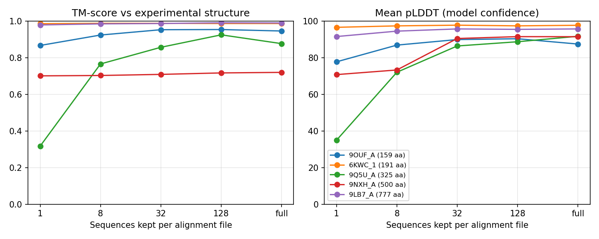

# Proof of concept: how much does OpenFold depend on the MSA?

OpenFold predicts a structure from two inputs besides the sequence: a multiple sequence alignment (MSA) of related sequences, and templates (known structures of similar proteins). The MSA search is the slowest step of the whole workflow (up to about 6 hours per protein on PACE, README section 6.3) and fails for proteins with few known relatives. This experiment asks how much prediction accuracy drops as the MSA shrinks, down to the single sequence alone, while everything else stays the same.

It reuses the recipe's baseline (README section 7): same OpenFold commit, `model_1_ptm` parameters, seed 42, templates, and proteins. The full-MSA results in `results/measurements/` are the control.

## Method

`scripts/cut_msa.py` copies a protein's precomputed alignment folder and keeps only the first N sequences of each MSA file (`bfd_uniref_hits.a3m`, `uniref90_hits.sto`, `mgnify_hits.sto`), the query included. N = 1 means single-sequence input. The template file (`hhsearch_output.hhr`) is copied unchanged, so only the MSA changes. Files list hits from best to worst match, so the first N are the closest relatives.

`scripts/run_msa_depth.sh` runs `scripts/measure_inference.py` for N = 1, 8, 32, and 128, one forward pass each (`--warmup 0 --repeats 1`; the timing column therefore includes first-pass setup and is only a rough guide). `scripts/summarize_msa_depth.py` joins the runs with the full-MSA baseline into `summary.md`, `summary.csv`, and `msa_depth.png`.

## Reproduce

Needs the environment and unpacked alignments from the main README (sections 1 and 6.1). On a GPU node (about 35 minutes for the five proteins below on one A100):

```bash
salloc --account=coc --partition=coc-gpu --gres=gpu:a100:1 --cpus-per-task=8 --mem=64G --time=02:00:00
cd "$RECIPE"
./scripts/run_msa_depth.sh 9OUF_A 6KWC_1 9Q5U_A 9NXH_A 9LB7_A > msa-depth/run.log 2>&1
python scripts/summarize_msa_depth.py
```

Set `DEPTHS` to try other values, for example `DEPTHS="1 4 16"`. Results go to `msa-depth/results/depth-<N>/`, with one folder per protein as in the main README section 6.

## Results

Run on 2026-11-22, job 7247593, one NVIDIA L40S (46 GB) on `coc-gpu` (an A100 was requested but not assigned in time; GPU type does not change accuracy, README section 6.3). Log: `msa-depth/run-7247593.log`. All 20 runs finished with status `ok`. "full" is the committed A100 baseline (job 6886502).

| Protein | Residues | MSA depth | Time (s) | Mean pLDDT | pTM | TM-score | lDDT | RMSD (Å) |
|---|---|---|---|---|---|---|---|---|
| 9OUF_A | 159 | 1 | 23.4 | 77.8 | 0.71 | 0.87 | 0.83 | 6.18 |
| 9OUF_A | 159 | 8 | 8.8 | 86.9 | 0.79 | 0.92 | 0.89 | 3.59 |
| 9OUF_A | 159 | 32 | 8.9 | 89.9 | 0.80 | 0.95 | 0.94 | 3.16 |
| 9OUF_A | 159 | 128 | 8.8 | 90.4 | 0.81 | 0.95 | 0.94 | 3.16 |
| 9OUF_A | 159 | full | 6.1 | 87.5 | 0.77 | 0.95 | 0.92 | 2.98 |
| 6KWC_1 | 191 | 1 | 11.7 | 96.6 | 0.92 | 0.99 | 0.98 | 1.00 |
| 6KWC_1 | 191 | 8 | 11.5 | 97.4 | 0.93 | 0.99 | 0.98 | 0.94 |
| 6KWC_1 | 191 | 32 | 11.7 | 97.8 | 0.93 | 0.99 | 0.98 | 0.95 |
| 6KWC_1 | 191 | 128 | 11.5 | 97.4 | 0.93 | 0.99 | 0.98 | 0.96 |
| 6KWC_1 | 191 | full | 7.8 | 97.7 | 0.93 | 0.99 | 0.98 | 0.96 |
| 9Q5U_A | 325 | 1 | 27.0 | 34.9 | 0.31 | 0.32 | 0.29 | 19.64 |
| 9Q5U_A | 325 | 8 | 27.0 | 72.1 | 0.72 | 0.77 | 0.75 | 4.23 |
| 9Q5U_A | 325 | 32 | 27.0 | 86.4 | 0.83 | 0.86 | 0.84 | 2.94 |
| 9Q5U_A | 325 | 128 | 27.0 | 88.7 | 0.86 | 0.93 | 0.87 | 2.11 |
| 9Q5U_A | 325 | full | 18.8 | 91.7 | 0.88 | 0.88 | 0.87 | 2.67 |
| 9NXH_A | 500 | 1 | 60.3 | 70.8 | 0.68 | 0.70 | 0.72 | 16.08 |
| 9NXH_A | 500 | 8 | 60.3 | 73.3 | 0.69 | 0.70 | 0.78 | 17.25 |
| 9NXH_A | 500 | 32 | 61.0 | 90.5 | 0.71 | 0.71 | 0.94 | 14.51 |
| 9NXH_A | 500 | 128 | 60.3 | 91.5 | 0.70 | 0.72 | 0.94 | 11.24 |
| 9NXH_A | 500 | full | 39.8 | 91.5 | 0.69 | 0.72 | 0.94 | 12.85 |
| 9LB7_A | 777 | 1 | 160.9 | 91.6 | 0.93 | 0.98 | 0.92 | 1.58 |
| 9LB7_A | 777 | 8 | 160.0 | 94.5 | 0.94 | 0.98 | 0.96 | 1.38 |
| 9LB7_A | 777 | 32 | 160.3 | 95.7 | 0.94 | 0.99 | 0.97 | 1.34 |
| 9LB7_A | 777 | 128 | 160.0 | 95.5 | 0.94 | 0.99 | 0.97 | 1.05 |
| 9LB7_A | 777 | full | 110.2 | 95.7 | 0.94 | 0.99 | 0.97 | 1.12 |



Best template found by the template search (`hhsearch_output.hhr`, top hit), which explains most of the pattern:

| Protein | Best template | Probability | Aligned length |
|---|---|---|---|
| 6KWC_1 | 2DFB_A, xylanase | 100% | 189 of 191 residues |
| 9LB7_A | 4KTP_A, glycoside hydrolase | 100% | 730 of 777 residues |
| 9NXH_A | 3AKH_A, alpha-L-arabinofuranosidase | 100% | 318 of 500 residues (one domain) |
| 9OUF_A | 3GC6_A, ecto-NAD+ glycohydrolase | 99.6% | 122 of 159 residues |
| 9Q5U_A | 1V8H_A, SoxZ protein | 33.5% | 45 of 325 residues (no real template) |

Observations:

- **Without a good template, the MSA is essential.** 9Q5U, the only protein with no real template, collapses with the single sequence (TM-score 0.32, RMSD 19.6 Å: the wrong fold) and recovers step by step as sequences are added (0.77 at 8, 0.86 at 32, 0.93 at 128).
- **With a full-length template, the MSA hardly matters.** 6KWC (TM-score 0.99 at every depth) and 9LB7 (0.98 with the single sequence) are predicted almost as well from the sequence alone.
- **Partial templates need a modest MSA.** 9OUF (template covers 77% of the chain) reaches its full accuracy at 32 sequences. For 9NXH, the template covers one domain; the per-domain accuracy (lDDT) needs 32 sequences to reach 0.94, and the whole-chain TM-score stays near 0.72 at every depth because the relative placement of the two domains is never recovered.
- **Confidence tracks accuracy.** Mean pLDDT falls with accuracy (9Q5U: 35 at depth 1, 72 at depth 8), so OpenFold flags its own failures here.
- **Depth does not change speed.** Each protein's time is the same at every depth, because OpenFold pads the MSA to a fixed size in prediction mode. On the L40S, single passes without warm-up were about 1.4–1.5 times slower than the A100 baseline.
- 9Q5U at depth 128 scored higher than with the full MSA (TM-score 0.93 compared with 0.88). This is one run per setting; OpenFold samples MSA rows at random (fixed seed), so a single comparison between close values is not conclusive.
