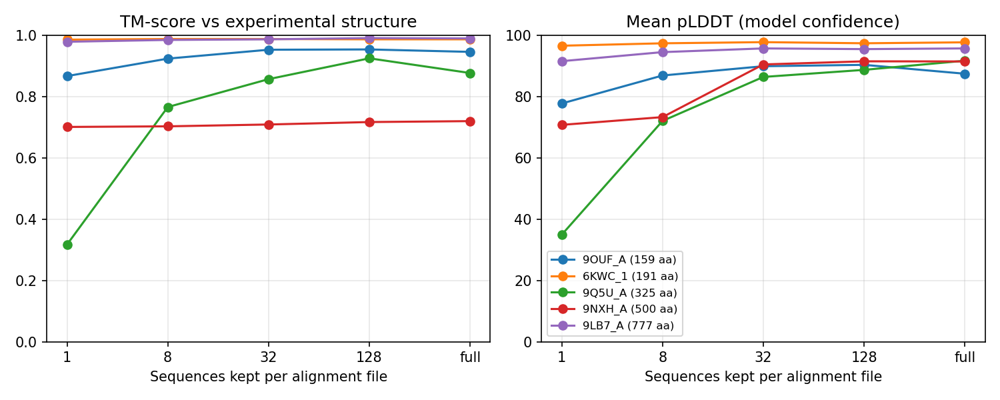

## Submission links

- **GitHub (experiment code and results, branch `openfold-msa-depth`):** https://github.com/Yuhwa-L/cybershuttle-ai4science-foundry/tree/openfold-msa-depth/registry/models/openfold/yuhwa-l-reproducible-inference/msa-depth
- **CyberShuttle contribution this builds on (pull request #41):** https://github.com/cyber-shuttle/cybershuttle-ai4science-foundry/pull/41
- **Presentation recording (unlisted YouTube):** YOUTUBE_LINK

All code, runs, and analysis in this report are my own work; no collaborators.

## 1. Research objective

**Starting point.** My CyberShuttle contribution is a reproducible OpenFold inference recipe on Georgia Tech PACE/ICE: six proteins from 159 to 1,125 residues, precomputed inputs, validation against experimental structures, and baseline measurements of inference time, GPU memory, and accuracy. OpenFold (an open-source PyTorch reimplementation of AlphaFold2) predicts a protein's 3D structure from two kinds of input besides the sequence:

- a **multiple sequence alignment (MSA)**: related sequences from other organisms, found by searching large sequence databases; and
- **templates**: experimentally solved structures of similar proteins.

Building the MSA is by far the most expensive step of the workflow. In my recipe it took 2–6 hours per protein on 8 CPU cores, while the prediction itself takes 6–350 seconds on one GPU.

**Question.** How much prediction accuracy is lost as the MSA shrinks, down to the single input sequence, when everything else stays the same? And does OpenFold's own confidence score (pLDDT) notice the loss?

**Why it is useful.**

- If a few dozen sequences are enough, a much cheaper alignment search could replace the hours-long one.
- Proteins with few known relatives are where MSA-based models are expected to fail. Measuring how and when OpenFold fails motivates combining it with MSA-free protein language models such as ESM2/ESMFold, which are also in the Foundry.

**Approach.** Cut the precomputed alignments of five proteins to their first 1, 8, 32, and 128 sequences, rerun OpenFold with everything else unchanged, and score each prediction against the experimental structure. The full-alignment results from my baseline are the control.

**Anticipated challenges.**

- In prediction mode OpenFold pads every input to a fixed 512 MSA rows, so the depth cannot be set with a model option; the alignment files themselves have to be cut.
- Templates are a second source of information and can hide the effect of the MSA (6KWC has near-identical templates).
- GPU time on the shared `coc-gpu` partition is limited, and queue waits are unpredictable.

## 2. Implementation

New code, all in the experiment branch:

| File | What it does |
|---|---|
| `scripts/cut_msa.py` | Copies a protein's alignment folder and keeps only the first N sequences of each MSA file (`bfd_uniref_hits.a3m`, `uniref90_hits.sto`, `mgnify_hits.sto`), the query included. Handles both A3M and Stockholm formats. The template search result (`hhsearch_output.hhr`) is copied unchanged, so only the MSA changes. N = 1 is single-sequence input. |
| `scripts/run_msa_depth.sh` | For each protein and each N in 1, 8, 32, 128: cuts the alignments, then runs the recipe's existing `measure_inference.py` with the same model, random seed, and template date cutoff as the baseline. |
| `scripts/summarize_msa_depth.py` | Joins all runs with the committed full-MSA baseline into `summary.md`, `summary.csv`, and the plot `msa_depth.png`. |
| `msa-depth/README.md` | How to reproduce the experiment, results, and observations. Also linked from section 8 of the recipe README. |

Reused unchanged from my CyberShuttle recipe: the Conda environment, the OpenFold checkout and parameters, the precomputed alignments, the accuracy metrics (`structure_metrics.py`: TM-score, C-alpha lDDT, C-alpha RMSD), and the baseline results. Each protein's templates are limited to structures released before its own experimental structure, so OpenFold cannot copy the answer.

While preparing this work I also restructured the recipe so that all six proteins go through one workflow from the start (one shared protein list, `proteins.tsv`; six-protein inference and validation scripts). That change is in PR #41.

## 3. Environment and procedure

| Item | Value |
|---|---|
| Cluster | Georgia Tech PACE/ICE, `coc-gpu` partition |
| GPU | One NVIDIA L40S 46 GB (job 7247593). An A100 was requested but not assigned in time. Baseline: NVIDIA A100-PCIE-40GB (job 6886502). |
| Software | OpenFold commit `be2ec18`, PyTorch 2.5.1, CUDA 12.4, Python 3.10, environment from the recipe's `environment.yml` |
| Model | `model_1_ptm` AlphaFold parameters (PACE shared copy), seed 42, no relaxation |
| Proteins | 9OUF_A (159 residues), 6KWC_1 (191), 9Q5U_A (325), 9NXH_A (500), 9LB7_A (777) |

Steps, after the recipe's setup (README sections 1 and 2.1: environment, unpacked alignments):

```bash
salloc --account=coc --partition=coc-gpu --gres=gpu:l40s:1 --cpus-per-task=8 --mem=64G --time=02:00:00
cd "$RECIPE"
./scripts/run_msa_depth.sh 9OUF_A 6KWC_1 9Q5U_A 9NXH_A 9LB7_A > msa-depth/run.log 2>&1
python scripts/summarize_msa_depth.py
```

The 20 runs took 31 minutes. The sixth protein, 8P5S (1,125 residues), was left out because of time: about 6 minutes per forward pass.

## 4. Experimental evidence

All 20 runs (5 proteins × 4 depths) finished with status `ok`. Excerpt from the job log (`msa-depth/run-7247593.log`):

```text
Date: 2026-11-22T22:30:29-05:00  Job: 7247593  Node: atl1-1-03-004-21-0.pace.gatech.edu
NVIDIA L40S, 46068 MiB
9Q5U_A/bfd_uniref_hits.a3m: kept 1 sequences
9Q5U_A/mgnify_hits.sto: kept 1 sequences
9Q5U_A/uniref90_hits.sto: kept 1 sequences
=== 9Q5U_A (325 residues) -> .../msa-depth/results/depth-1/9Q5U_A ===
=== 9Q5U_A: ok ===
```

**TM-score against the experimental structure** (0 to 1; above 0.5 means the fold is right, above 0.9 near-identical), with mean pLDDT (OpenFold's confidence, 0–100) in brackets:

| Protein | Depth 1 | Depth 8 | Depth 32 | Depth 128 | Full MSA |
|---|---|---|---|---|---|
| 9OUF_A (159) | 0.87 (78) | 0.92 (87) | 0.95 (90) | 0.95 (90) | 0.95 (88) |
| 6KWC_1 (191) | 0.99 (97) | 0.99 (97) | 0.99 (98) | 0.99 (97) | 0.99 (98) |
| 9Q5U_A (325) | **0.32 (35)** | 0.77 (72) | 0.86 (86) | 0.93 (89) | 0.88 (92) |
| 9NXH_A (500) | 0.70 (71) | 0.70 (73) | 0.71 (91) | 0.72 (92) | 0.72 (92) |
| 9LB7_A (777) | 0.98 (92) | 0.98 (95) | 0.99 (96) | 0.99 (96) | 0.99 (96) |



**Best template found by the template search** (top hit in `hhsearch_output.hhr`), which explains most of the pattern:

| Protein | Best template | Probability | Aligned length |
|---|---|---|---|
| 6KWC_1 | 2DFB_A, xylanase | 100% | 189 of 191 residues |
| 9LB7_A | 4KTP_A, glycoside hydrolase | 100% | about 730 of 777 |
| 9NXH_A | 3AKH_A, alpha-L-arabinofuranosidase | 100% | about 318 of 500 (one domain) |
| 9OUF_A | 3GC6_A, ecto-NAD+ glycohydrolase | 99.6% | about 122 of 159 |
| 9Q5U_A | 1V8H_A, SoxZ protein | 33.5% | 45 of 325 (no real template) |

The full table (time, pTM, lDDT, RMSD for every run) is in the appendix and in `msa-depth/summary.md`. Every run's predicted structure, structure superposed on the experimental one, per-residue confidence, and exact OpenFold command are in `msa-depth/results/depth-<N>/<protein>/`.

## 5. Observations and next steps

**Observations.**

- **Without a good template, the MSA is essential.** 9Q5U, the only protein with no real template, collapses with the single sequence (TM-score 0.32, RMSD 19.6 Å: the wrong fold). It recovers step by step as sequences are added: 0.77 at 8, 0.86 at 32, 0.93 at 128.
- **With a full-length template, the MSA hardly matters.** 6KWC (0.99 at every depth) and 9LB7 (0.98 with the single sequence) are predicted almost as well from the sequence alone as with thousands of aligned sequences.
- **Partial templates need a modest MSA.** 9OUF (template covers about 77% of the chain) reaches its full accuracy at 32 sequences. For 9NXH the template covers one domain: per-domain accuracy (lDDT) needs 32 sequences to reach 0.94, and the whole-chain TM-score stays near 0.72 at every depth, because the placement of the two domains relative to each other is never recovered.
- **Confidence tracks accuracy.** Mean pLDDT falls with accuracy (9Q5U: 35 at depth 1, 72 at depth 8), so OpenFold flags its own failures in these cases.
- **Depth does not change speed.** Each protein's time is the same at every depth, because OpenFold pads the MSA to a fixed size. (On the L40S, single passes without warm-up were about 1.4–1.5 times slower than the A100 baseline.)
- 9Q5U scored higher at depth 128 than with the full MSA (0.93 compared with 0.88). With one run per setting and random sampling of MSA rows, this difference is not conclusive.

**What I learned.** OpenFold's need for the MSA depends less on protein length than on how much other information is available. With a close template, a single sequence is nearly enough, so the hours-long alignment search could be skipped or shortened. Without a template, the alignment is the main source of structural information, and a few dozen sequences recover most of the accuracy. Because pLDDT flagged the failures, a cheap first pass with a shallow MSA followed by a confidence check is a practical workflow to test next.

**Technical notes.** OpenFold has no option to set MSA depth at prediction time (inputs are padded to 512 rows), so I implemented the cut on the alignment files. The A100 queue did not assign a GPU in time, so the sweep ran on an L40S; my earlier A100 40GB versus 80GB comparison showed that GPU type does not change accuracy, only timing.

**Unresolved.**

- One run per setting, with no repeats under different random seeds.
- Only five proteins, and only one of them lacks a template.
- Templates were not turned off, so their contribution is inferred from the template search output rather than measured directly.

**Next steps.**

1. **Cross-model comparison:** run ESMFold, which replaces the MSA with the ESM2 protein language model (already in the Foundry), on the same proteins, and compare it with OpenFold at depth 1 and with the full MSA. 9Q5U is the key test case.
2. **Separate the two information sources:** repeat the sweep with templates turned off.
3. **Scale up:** add 8P5S and the planned 40-protein set, repeat each setting with several seeds, and test smarter subsampling (for example, the most diverse sequences rather than the top hits).
4. **Feed into my optimization project:** if accuracy holds at moderate depth, a faster alignment search gives a larger end-to-end speed-up than any GPU-side change.

## Appendix: full results

"full" is the committed A100 baseline (job 6886502); all other rows are job 7247593 on the L40S. Time is one forward pass without warm-up.

| Protein | Residues | MSA depth | Time (s) | Mean pLDDT | pTM | TM-score | lDDT | RMSD (Å) |
|---|---|---|---|---|---|---|---|---|
| 9OUF_A | 159 | 1 | 23.4 | 77.8 | 0.71 | 0.87 | 0.83 | 6.18 |
| 9OUF_A | 159 | 8 | 8.8 | 86.9 | 0.79 | 0.92 | 0.89 | 3.59 |
| 9OUF_A | 159 | 32 | 8.9 | 89.9 | 0.80 | 0.95 | 0.94 | 3.16 |
| 9OUF_A | 159 | 128 | 8.8 | 90.4 | 0.81 | 0.95 | 0.94 | 3.16 |
| 9OUF_A | 159 | full | 6.1 | 87.5 | 0.77 | 0.95 | 0.92 | 2.98 |
| 6KWC_1 | 191 | 1 | 11.7 | 96.6 | 0.92 | 0.99 | 0.98 | 1.00 |
| 6KWC_1 | 191 | 8 | 11.5 | 97.4 | 0.93 | 0.99 | 0.98 | 0.94 |
| 6KWC_1 | 191 | 32 | 11.7 | 97.8 | 0.93 | 0.99 | 0.98 | 0.95 |
| 6KWC_1 | 191 | 128 | 11.5 | 97.4 | 0.93 | 0.99 | 0.98 | 0.96 |
| 6KWC_1 | 191 | full | 7.8 | 97.7 | 0.93 | 0.99 | 0.98 | 0.96 |
| 9Q5U_A | 325 | 1 | 27.0 | 34.9 | 0.31 | 0.32 | 0.29 | 19.64 |
| 9Q5U_A | 325 | 8 | 27.0 | 72.1 | 0.72 | 0.77 | 0.75 | 4.23 |
| 9Q5U_A | 325 | 32 | 27.0 | 86.4 | 0.83 | 0.86 | 0.84 | 2.94 |
| 9Q5U_A | 325 | 128 | 27.0 | 88.7 | 0.86 | 0.93 | 0.87 | 2.11 |
| 9Q5U_A | 325 | full | 18.8 | 91.7 | 0.88 | 0.88 | 0.87 | 2.67 |
| 9NXH_A | 500 | 1 | 60.3 | 70.8 | 0.68 | 0.70 | 0.72 | 16.08 |
| 9NXH_A | 500 | 8 | 60.3 | 73.3 | 0.69 | 0.70 | 0.78 | 17.25 |
| 9NXH_A | 500 | 32 | 61.0 | 90.5 | 0.71 | 0.71 | 0.94 | 14.51 |
| 9NXH_A | 500 | 128 | 60.3 | 91.5 | 0.70 | 0.72 | 0.94 | 11.24 |
| 9NXH_A | 500 | full | 39.8 | 91.5 | 0.69 | 0.72 | 0.94 | 12.85 |
| 9LB7_A | 777 | 1 | 160.9 | 91.6 | 0.93 | 0.98 | 0.92 | 1.58 |
| 9LB7_A | 777 | 8 | 160.0 | 94.5 | 0.94 | 0.98 | 0.96 | 1.38 |
| 9LB7_A | 777 | 32 | 160.3 | 95.7 | 0.94 | 0.99 | 0.97 | 1.34 |
| 9LB7_A | 777 | 128 | 160.0 | 95.5 | 0.94 | 0.99 | 0.97 | 1.05 |
| 9LB7_A | 777 | full | 110.2 | 95.7 | 0.94 | 0.99 | 0.97 | 1.12 |
